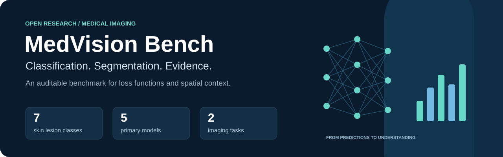
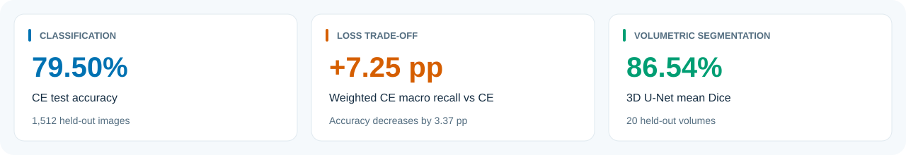
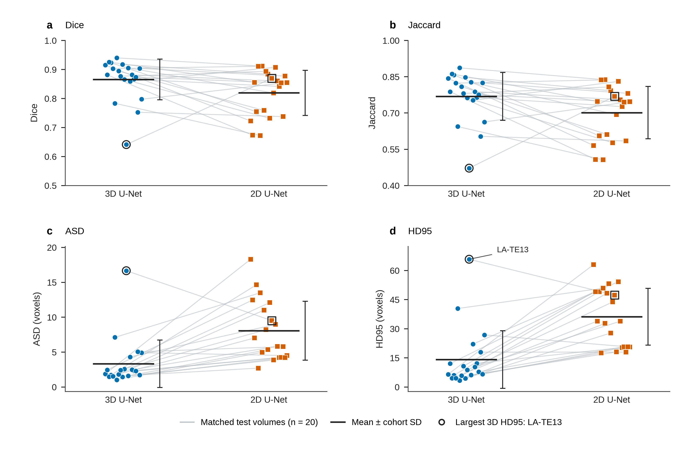
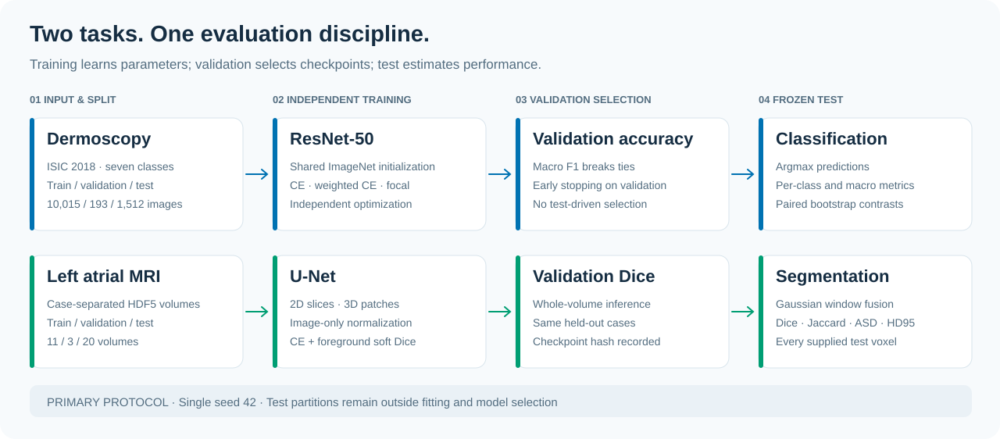

<p align="center">
  <a href="https://github.com/ZhipengXx/medvision-bench/actions/workflows/ci.yml"></a>
  
</p>

<p align="center">
  <a href="LICENSE"></a>
  
  
  
  
</p>

<p align="center">
  <a href="#results">Results</a> ·
  <a href="#method">Method</a> ·
  <a href="#quickstart">Quickstart</a> ·
  <a href="report/report.pdf">Research report</a> ·
  <a href="docs/reproducibility.md">Reproducibility</a>
</p>

**MedVision Bench** studies two practical questions in medical imaging: how imbalance-aware losses change skin lesion predictions, and how volumetric context affects left atrial segmentation. It pairs a compact PyTorch implementation with saved predictions, case-level measurements, uncertainty analysis and publication-quality figures.

The emphasis is on understanding the measured trade-offs. Weighted cross-entropy increases macro recall while reducing overall accuracy; 3D U-Net improves average overlap and surface distances over the tested 2D baseline. Both findings are reported alongside their limits.



## Results

### Skin lesion classification

Three ResNet-50 models start from the same ImageNet-pretrained weights and seeded classifier head. The primary comparison changes the loss while retaining the fitting and validation-selection settings. Evaluation uses all **1,512** ISIC 2018 Task 3 test images across seven classes.

| Loss | Accuracy ↑ | Macro recall ↑ | Macro F1 ↑ | Macro AUROC ↑ |
|:--|--:|--:|--:|--:|
| Cross-entropy | **79.50%** | 62.75% | 67.35% | **0.9574** |
| Weighted cross-entropy | 76.12% | **70.00%** | 66.16% | 0.9527 |
| Focal, γ = 2 | 78.64% | 63.83% | **67.62%** | 0.9544 |


**Reading the trade-off.** Weighted CE changes accuracy by **−3.37 percentage points** (95% CI −5.49 to −1.19) and macro recall by **+7.25 points** (3.05 to 11.61), relative to CE. Focal's macro-F1 difference is **+0.27 points**, with an interval spanning zero (−3.65 to 4.26). Its small point-estimate advantage does not establish an improvement.

Intervals use 10,000 paired, true-class-stratified bootstrap replicates. They condition on the fitted models and observed class counts; they do not include variation across training seeds or unavailable patient/lesion clusters.

[Summary CSV](results/classification/summary.csv) · [Paired estimates](results/loss_diagnostics.csv) · [Figure PDF](results/figures/classification_main.pdf) · [Figure source data](results/figure_source_data/)

### Left atrial segmentation

2D and 3D U-Nets share case partitions, normalization and the CE + foreground soft-Dice objective. Checkpoints are selected using full validation-volume Dice. Test metrics give each of the **20 held-out volumes** equal weight.

| Model | Mean Dice ↑ | Mean Jaccard ↑ | ASD, voxels ↓ | HD95, voxels ↓ |
|:--|--:|--:|--:|--:|
| 2D U-Net | 81.96% | 70.14% | 8.07 | 36.16 |
| 3D U-Net | **86.54%** | **76.89%** | **3.34** | **14.17** |



Each thin line joins the two measurements from the same volume. The 3D model has higher Dice in **15/20** cases and lower HD95 in **17/20**; a marked failure illustrates why averages require case-level inspection. The plotted spread summaries are population standard deviations, not confidence intervals. Physical spacing was unavailable, so all surface distances are in **voxels**.

[Summary CSV](results/segmentation/summary.csv) · [3D case metrics](results/segmentation/seg_unet3d/per_case_metrics.csv) · [2D case metrics](results/segmentation/seg_unet2d/per_case_metrics.csv) · [Figure PDF](results/figures/segmentation_main.pdf)

## Method



| | Classification | Segmentation |
|:--|:--|:--|
| Input | RGB dermoscopy, 224 × 224 | HDF5 MRI + binary foreground mask |
| Partitions | 10,015 train / 193 validation / 1,512 test | 11 train / 3 validation / 20 test volumes |
| Model | ImageNet-pretrained ResNet-50 | Four-level 2D / 3D U-Net, base width 16 |
| Training | AdamW; CE / inverse-frequency CE / focal | AdamW; CE + soft Dice; foreground-aware patches |
| Selection | Validation accuracy; macro F1 breaks ties | Mean Dice over complete validation volumes |
| Inference | Argmax, no test-time augmentation | Gaussian probability fusion; argmax, no postprocessing |
| Evaluation unit | Image | Complete volume |

The 3D configuration uses **80 × 112 × 112** patches in internal ZYX order; the 2D configuration uses **112 × 112** patches. Both reconstruct the full supplied volume. Model capacity and sampling exposure differ, so the observed difference cannot be attributed to spatial context alone.


### A separate selection-sensitivity study

Three supplemental classification runs select checkpoints using validation macro F1 and enforce at least 20 epochs. This protocol was designed **after viewing the primary test results**. It is exploratory, remains separate under [`results/sensitivity/`](results/sensitivity/), and requires a new untouched test set for a confirmatory improvement claim.

## Quickstart

### 1. Install

The measured environment used **Python 3.12**, PyTorch 2.6 and CUDA 12.6. Run commands from the repository root. An NVIDIA GPU is needed for the published training configurations; the retained numeric results can be inspected without data or checkpoints.

```bash
git clone https://github.com/ZhipengXx/medvision-bench.git
cd medvision-bench

python3.12 -m venv .venv
source .venv/bin/activate
python -m pip install --upgrade pip
python -m pip install -r requirements.txt
```

For the exact measured CUDA 12.6 package set, install `requirements.lock.txt` with
`--extra-index-url https://download.pytorch.org/whl/cu126` instead. GPU training
requires a compatible NVIDIA driver; see [reproducibility](docs/reproducibility.md).

### 2. Prepare your data

Follow [`docs/data.md`](docs/data.md) for dataset sources, expected layouts, label keys and geometry assumptions, then edit [`configs/data.yaml`](configs/data.yaml). Raw images, MRI volumes and binary checkpoints are not distributed here.

```bash
python scripts/audit_data.py --config configs/data.yaml
python -m pytest tests -q
```

The audit reads and hashes local inputs, verifies labels and duplicates, and writes split manifests. If you substitute a different segmentation release, its partitions and geometry must be documented; the saved segmentation scores apply only to the recorded input version.

### 3. Train in a new run directory

The repository retains historical run metadata. Make a local configuration with a new run ID so a fresh training run has its own output directory:

```bash
python - <<'PY'
from pathlib import Path
import yaml

source = Path('configs/cls_r50_ce.yaml')
config = yaml.safe_load(source.read_text())
config['run_id'] = 'cls_r50_ce_reproduction'
target = Path('configs/local/cls_r50_ce.yaml')
target.parent.mkdir(parents=True, exist_ok=True)
target.write_text(yaml.safe_dump(config, sort_keys=False))
PY

CUDA_VISIBLE_DEVICES=0 python scripts/train_classification.py \
  --config configs/local/cls_r50_ce.yaml
```

Use the same pattern for the two other classification configurations and the 2D/3D segmentation configurations. Segmentation training runs through `scripts/train_segmentation.py`. Add `--smoke` for a short independent debug run. See the [reproducibility guide](docs/reproducibility.md) for initialization, resuming, freezing and reevaluation.

### 4. Rebuild the presentation

These commands work from retained numeric results and training histories. They do not retrain a model:

```bash
python scripts/diagnose_classification.py
python scripts/verify_project.py
python scripts/make_figures.py --results results
python scripts/make_nature_figures.py --results results
python scripts/make_method_diagram.py
python scripts/make_readme_assets.py
```

The prebuilt manuscript is [`report/report.pdf`](report/report.pdf), with editable [`report/report.tex`](report/report.tex) and a [`Markdown version`](report/report.md). To rebuild the PDF, install XeLaTeX and the fonts/packages listed in [the reproducibility guide](docs/reproducibility.md), then run:

```bash
python scripts/build_report.py --results results --output report/report.pdf
```

Some image-based figure builders require the local datasets and checkpoints. The README artwork is original SVG, and the two result panels shown here use numerical measurements only.

## Explore the repository

```text
medvision-bench/
├── configs/             Model, data and sensitivity configurations
├── src/
│   ├── classification/  Dataset transforms, losses, model and metrics
│   ├── segmentation/    Patch sampling, U-Net, fusion and surface metrics
│   └── common/          Run tracking, figure style and native LaTeX typesetting
├── scripts/             Audit, train, evaluate, analyse and render
├── tests/               Implementation and numerical consistency checks
├── splits/              Recorded partitions and frozen evaluation manifests
├── outputs/             Retained configurations and training histories
├── results/             Predictions, metrics, diagnostics and vector figures
├── report/              Research manuscript and editable source
└── docs/                Data, reproducibility and showcase artwork
```

## Scope and reuse

This is a research benchmark with a **single training seed**. It does not establish clinical performance, patient-level independence, calibration or deployment readiness. Training lesion groupings are incomplete across validation/test; byte-level duplicate checks cannot resolve all related-image leakage. Segmentation geometry is inferred from preprocessing conventions, with no trustworthy physical spacing or anatomical orientation metadata.

Original code is released under the [MIT license](LICENSE). Dermoscopy examples and their Grad-CAM derivatives retain **CC BY-NC 4.0** terms, with attribution and adaptation details in [NOTICE](NOTICE). Obtain complete datasets from their original sources and follow the [data guide](docs/data.md). The [research report](report/report.pdf) documents the implementation, measured outcomes and limitations in detail.
