# Loss rebalancing in skin lesion classification and spatial context in atrial segmentation

MedVision Bench · Controlled comparisons in medical image analysis

Minority-class recognition and anatomical continuity place different demands on medical image analysis. We examined loss rebalancing for seven-class skin lesion classification and volumetric context for left atrial segmentation. Three ResNet-50 classifiers were evaluated on 1,512 ISIC test images, and two U-Nets on 20 complete MRI volumes. Inverse-frequency weighted cross-entropy increased macro recall from 62.75% to 70.00%, while reducing accuracy from 79.50% to 76.12%. Focal loss produced the highest observed melanoma recall, although its overall accuracy and macro-F1 differences from the baseline remained uncertain. The 3D U-Net improved mean Dice from 81.96% to 86.54% and reduced mean 95th-percentile Hausdorff distance from 36.16 to 14.17 voxels. It nevertheless failed substantially on one volume and omitted a small structure in its highest-Dice case. Loss rebalancing changed which diagnoses were recognised, and volumetric modelling improved average geometry without removing individual failures. Class-specific recall and complete-volume boundary assessment expose these differences beyond aggregate scores.

Errors in medical image analysis vary with the structure of the task. In dermoscopic classification, a frequent diagnosis can dominate accuracy while a smaller diagnostic group remains poorly recognised. The ISIC 2018 seven-class task makes this imbalance explicit: melanocytic naevi constitute most training images, whereas dermatofibromas and vascular lesions are uncommon. A classifier can therefore label many images correctly while offering uneven coverage across diagnoses. The relevant comparison includes both the number of correct decisions and their distribution among classes. [1,2]

The training objective determines how each image contributes to fitting. Ordinary cross-entropy treats images equally before averaging, inverse-frequency weighting increases the relative influence of rare diagnoses, and focal loss reduces the contribution of examples that the model already classifies confidently. These choices need not produce the same decision boundary or the same balance between precision and recall. In particular, improved recognition of a small class can coexist with additional errors in a much larger class. Shared initialization, architecture and preprocessing help locate such changes within a controlled comparison of objectives. [3,4]

For atrial segmentation, the difficulty also concerns where an error occurs. A mask may reproduce most of the annotated cavity while omitting a small extension or adding a distant foreground component. Dice summarizes overlap, but does not describe the position of the affected boundary. A 2D U-Net predicts slices independently; a 3D U-Net can use neighbouring image planes to represent continuity and disambiguate local appearance. Volumetric modelling also changes parameter count, batch size and training exposure, so an observed advantage belongs to the implemented pipeline and cannot automatically be attributed to spatial context alone. [5,6,7]

Model selection provides another constraint on these comparisons. Minority-class validation scores can change sharply when only a few reference examples are available, while segmentation rankings based on a small number of validation volumes may depend on particular anatomies or image appearances. The eventual test score therefore reflects the training objective, fitting trajectory and validation rule together. Separating the original comparison from a later change in checkpoint selection helps establish which conclusions were tested before the outcomes were known.

We compare ordinary cross-entropy, inverse-frequency weighted cross-entropy and focal loss in an identically initialized ResNet-50, and compare 2D and 3D U-Nets on common atrial MRI case splits. We assess class-specific recognition, paired image-level changes and complete-volume overlap and surface distances. Activation maps and selected mask failures connect these measurements to visible image regions, while an exploratory selection analysis examines the sensitivity of the classification result to the validation criterion. The aim is to identify the error trade-offs supported by these experiments and the limits of their interpretation for supervised review.

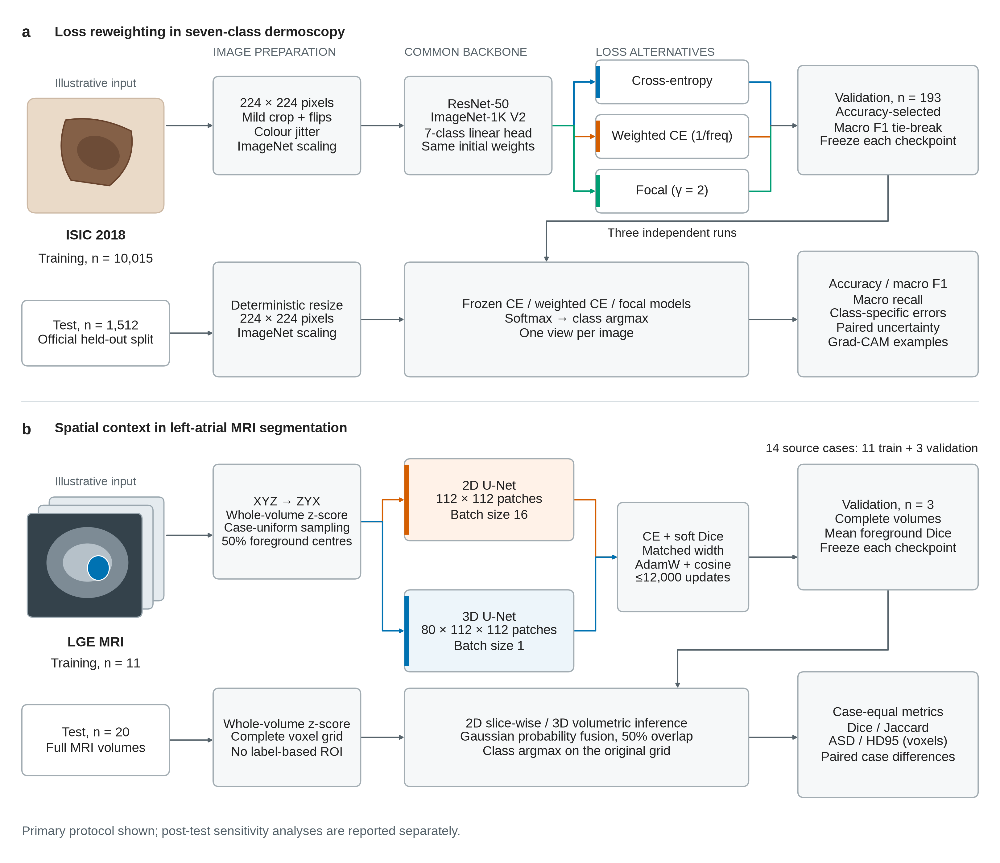

**Fig. 1 |** Study design and evaluation. a, Three independently trained ResNet-50 classifiers share an ImageNet-1K V2 initialization and image preparation, differing only in their training objective. Each checkpoint is selected on the official validation set by accuracy, with macro F1 as a tie-breaker, then evaluated on 1,512 held-out dermoscopy images. b, Left-atrial MRI training uses 11 of the 14 supplied source volumes, with three retained for validation. Case-uniform, partly foreground-centred sampling supplies either 2D patches or 3D patches to U-Nets with matched channel widths. Checkpoints are selected by mean foreground Dice on complete validation volumes. Frozen models reconstruct the full grids of 20 test volumes using Gaussian probability fusion. ASD and HD95 are expressed in voxel units because physical image spacing is unavailable. The modality icons are illustrative vector drawings rather than dataset images or anatomical evidence. Supplementary sensitivity runs performed after inspection of the primary test results are outside this primary design.

## Results

### Uneven recall across diagnoses

The cross-entropy baseline classified 1,202 of 1,512 test images correctly, giving an accuracy of 79.50%. Performance was uneven across diagnoses: recall reached 90.43% for naevi (NV), but only 60.82% for melanoma (MEL), 44.19% for actinic keratosis/intraepithelial carcinoma (AKIEC) and 42.86% for vascular lesions (VASC). Macro recall (62.75%) and macro F1 (67.35%) were consequently lower than support-weighted F1 (79.41%). The macro area under the receiver operating characteristic curve was 0.9574, indicating that good probability ranking coexisted with errors at the fixed maximum-probability decision rule (Table 1; Extended Data Figs. 1–3).

**Table 1 |** Skin lesion classification on 1,512 test images. Precision, recall and F1 are macro averages over seven diagnoses. AUROC is macro one-versus-rest; all other values are percentages.

| Objective | Accuracy | Precision | Recall | F1 | AUROC |
| --- | --- | --- | --- | --- | --- |
| Cross-entropy | 79.50 | 76.69 | 62.75 | 67.35 | 0.9574 |
| Weighted cross-entropy | 76.12 | 64.31 | 70.00 | 66.16 | 0.9527 |
| Focal loss | 78.64 | 74.73 | 63.83 | 67.62 | 0.9544 |

### Weighting trades accuracy for recall

Inverse-frequency weighted cross-entropy shifted predictions away from the dominant NV class. Macro recall increased by 7.25 percentage points to 70.00%, while accuracy decreased by 3.37 points to 76.12%. Paired 95% bootstrap intervals were 3.05 to 11.61 points for the recall increase and -5.49 to -1.19 points for the accuracy difference. Recall rose most for AKIEC (44.19% to 65.12%), dermatofibroma (DF; 63.64% to 79.55%) and VASC (42.86% to 65.71%). This broader coverage came with lower macro precision (64.31% versus 76.69%). The confusion matrices locate the cost: 161 NV images received another label, compared with 87 under the baseline. The added errors included NV images assigned to MEL (51 to 74) or benign keratosis-like lesions (BKL; 26 to 56). MEL-to-NV errors decreased from 52 to 33, although correct MEL recall increased only to 61.99% because some errors shifted to other diagnoses. Focal loss produced the highest observed MEL recall (67.84%; 116 of 171 images) and macro F1 (67.62%). Its effect was class dependent: basal cell carcinoma (BCC) recall fell to 49.46%, compared with 67.74% for the baseline and 66.67% for weighted cross-entropy. Differences between focal loss and the baseline were small overall. The accuracy difference was -0.86 points (95% interval -2.71 to 0.99), and the macro-F1 difference was 0.27 points (95% interval -3.65 to 4.26); neither interval resolved the direction of the effect. Weighted cross-entropy therefore improved average class coverage at a measurable cost in accuracy, whereas focal loss mainly redistributed errors among classes (Fig. 2).

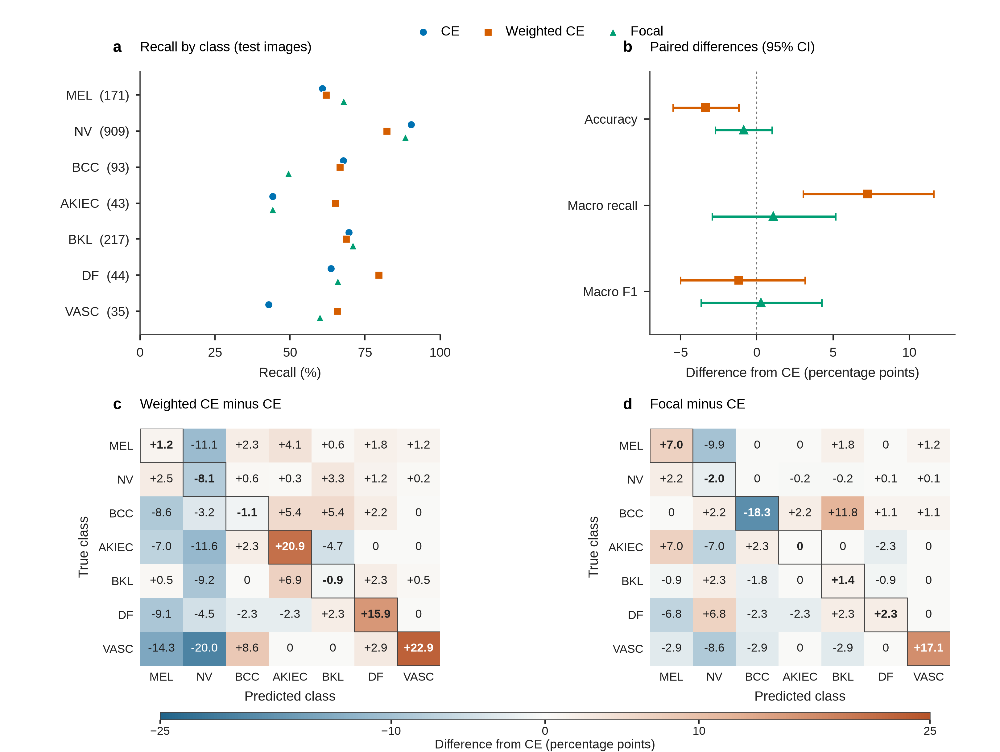

**Fig. 2 |** Class-specific changes under loss rebalancing. a, Recall for seven diagnoses; values in parentheses give test support (n = 1,512 images in total). b, Weighted cross-entropy and focal differences from cross-entropy in percentage points. Symbols show point estimates and lines show paired, true-class-stratified 95% bootstrap intervals from 10,000 resamples. These intervals condition on fitted models and observed class composition and are not multiplicity-adjusted. c,d, Changes in row-normalized confusion relative to cross-entropy, in percentage points, for weighted cross-entropy and focal loss. Rows denote ground truth and columns predicted diagnosis. All three models were trained once from the same initialization.

### High confidence in incorrect predictions

The correct NV and MEL examples show strong activation over lesion pigmentation and heterogeneous interior texture. In the MEL image assigned NV, responses peak near a peripheral mark and the presentation boundary. The VASC image assigned MEL activates over its dark, variable centre and lower border. These patterns associate the predicted score with local appearance and framing; they do not identify causal features or establish histological interpretation. Both incorrect examples have predicted probabilities above 99%, illustrating how confidence can persist in an incorrect decision (Fig. 3). [8]

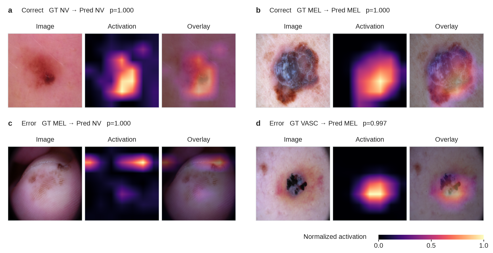

**Fig. 3 |** Predicted-class activation in four lesion images. Each case contains the input, activation map and overlay. a,b, Correct NV and MEL predictions. c,d, MEL assigned to NV and VASC assigned to MEL. Images were selected by prediction confidence with distinct reference diagnoses within each correctness group. Heatmaps were min–max normalized independently for each image and cannot compare activation magnitude between images. Displayed probabilities are rounded to three decimal places. NV, naevus; MEL, melanoma; VASC, vascular lesion.

The dermoscopy examples are adapted from ISIC 2018 Task 3 under the Creative Commons Attribution–NonCommercial 4.0 International licence. The source images were resized and accompanied by model activation maps; dataset attribution and source and licence links are recorded in NOTICE. [9,10]

### Lower mean boundary error with 3D

The 3D model improved mean Dice by 4.59 percentage points and reduced mean HD95 by 22.00 voxels, with higher Dice in 15 of 20 volumes and lower HD95 in 17. The selected cases locate the exceptions: a remote foreground component reverses the usual 3D advantage, a small omission persists in the highest-Dice case, and connected overgrowth produces large surface distances despite substantial cavity overlap (Table 2; Fig. 4).

**Table 2 |** Segmentation of 20 complete test volumes. Values are mean ± population standard deviation. Dice and Jaccard are percentages; symmetric average surface distance (ASD) and 95th-percentile Hausdorff distance (HD95) are in voxels. No empty-mask failures occurred.

| Model | Dice | Jaccard | ASD | HD95 |
| --- | --- | --- | --- | --- |
| 3D U-Net | 86.54 ± 7.01 | 76.89 ± 9.93 | 3.34 ± 3.40 | 14.17 ± 14.85 |
| 2D U-Net | 81.96 ± 7.77 | 70.14 ± 10.82 | 8.07 ± 4.22 | 36.16 ± 14.64 |

**Fig. 4 |** Paired segmentation outcomes across complete volumes. a–d, Dice, Jaccard, symmetric average surface distance (ASD) and 95th-percentile Hausdorff distance (HD95), respectively. Each pair represents the same test volume (n = 20); lines preserve the pairing. Black horizontal markers indicate means; offset capped intervals show population standard deviations across the 20-volume cohort (ddof = 0), not confidence intervals. The symmetric distance intervals can extend below zero although all individual distances are non-negative. Outlined points identify LA-TE13, the largest 3D HD95. Higher overlap and lower surface distance indicate closer agreement with the reference. Overlap axes cover the observed range; distance units are voxels because physical spacing is unavailable.

### High overlap leaves local errors

The poorest 3D result reverses the average model ranking. In LA-TE13, a distant foreground region and an omission give a 3D Dice of 64.12% and HD95 of 65.81 voxels; the 2D Dice is 86.94%. At the other extreme, the highest-Dice 3D volume reaches 94.00% yet omits a small annotated cross-section. The two remaining cases show detached excess foreground and connected overgrowth. In the median-ranked volume, a 1.83% net volume bias conceals both false-positive and false-negative regions.

Complete-volume measurements and selected-case observations are retained in Supplementary Table 3 and the case records. MRI images and mask illustrations are not distributed in this repository.

### Checkpoint-selection sensitivity

An exploratory change to validation macro-F1 selection, with at least 20 training epochs, moved the weighted-loss checkpoint from epoch 2 to 18. Validation macro F1 rose from 74.76% to 80.97%, but test macro F1 increased by only 0.93 percentage points to 67.09%; accuracy decreased to 75.93% and macro recall to 64.50%. Cross-entropy and focal retained their original selected epochs and discrete test metrics. The experiment followed the original test comparison and cannot establish a confirmatory improvement (Extended Data Figs. 5,6; Supplementary Table 5).

### Recall gains reduce class precision

The classwise precision–recall positions clarify the cost of increased coverage. For AKIEC, weighted cross-entropy raises recall from 44.19% to 65.12% while precision falls from 73.08% to 43.75%. For DF, recall increases from 63.64% to 79.55%, with precision decreasing from 75.68% to 53.03%. These are fixed argmax operating points rather than threshold-swept curves (Extended Data Fig. 8). Comparison of validation and test outcomes also shows that the selected checkpoint ranking transfers imperfectly between the two partitions (Extended Data Fig. 9); neither the graphical comparison nor the later selection analysis was used to replace the primary models.

### Small mean bias conceals volume errors

The mean signed foreground voxel-count bias is +2.91% for 3D and +20.99% for 2D. The median absolute bias is 7.64% and 15.39%, respectively; 13 of 20 3D masks and 5 of 20 2D masks lie within 10% of the reference voxel count. The 2D model overestimates foreground in 19 cases, compared with 9 for 3D. Signed averages can cancel over- and underestimation, and a near-zero bias can coexist with misplaced foreground, as the median-ranked 3D case illustrates. These descriptive comparisons use voxel counts rather than calibrated physical volumes (Extended Data Figs. 10,11).

## Discussion

Inverse-frequency weighting increases the contribution of each rare-class image during fitting, whereas test accuracy gives each image one vote. Improved recognition of AKIEC, DF and VASC is therefore outweighed by additional errors in the larger NV group. The weighted model provides broader average class coverage, but also assigns more NV images to other diagnoses. Its value depends on the intended review task and the consequences of those additional assignments. The present experiment measures neither clinician workload nor diagnostic decisions, so the recall advantage alone cannot establish a benefit in practice.

Focal loss produces a different pattern. Its highest observed melanoma recall accompanies weaker BCC recognition and small overall differences from cross-entropy. The paired intervals leave the direction of the accuracy and macro-F1 changes unresolved. A single ranking by aggregate performance would conceal this redistribution of errors. Validation adds a further constraint: with one DF and three VASC images, class-specific checkpoint assessment depends on very few outcomes. Selecting by macro F1 changes the preferred weighted-loss checkpoint, but leaves that sampling constraint intact.

The segmentation comparison is more consistent across the test set. Access to adjacent slices offers a plausible explanation for improved continuity and lower surface distances, but the 3D network also has greater capacity and receives a different amount of voxel information per update. The reported gain should therefore be attributed to the complete 3D pipeline. The failure in LA-TE13 shows the practical limit: a network that usually improves geometry can still predict a substantial unrelated region of foreground.

Overlap and boundary measurements reveal complementary parts of that failure. A remote component raises surface distance, whereas the omission of a small annotated cross-section can remain in a high-Dice mask. Conversely, a small net volume bias can conceal false-positive and false-negative regions that approximately cancel. These observations motivate reviewing complete surfaces and local extensions together with the scalar scores. Such review requires restored physical geometry and expert anatomical interpretation before the errors can be related to clinical tolerances.

### Choice of a lesion review model

For a research prototype that places broad lesion coverage ahead of the number of correct labels, weighted cross-entropy is the preferred candidate. It provides the highest macro recall, improves AKIEC, DF and VASC detection, and retains substantially more BCC recall than focal loss. The increased classification of NV as other diagnoses could add to clinician review workload, which was not measured here. For a melanoma-prioritized prototype, focal loss would instead be the candidate because of its higher observed MEL recall, with the accompanying BCC weakness made explicit. Even that model assigned an incorrect diagnosis to 55 of 171 MEL images. Selection therefore depends on the intended review task; these results do not establish a model for independent clinical clearance.

### Implications for atrial modelling

Segmentation errors could alter the apparent size and shape of the left atrial cavity before ablation. Excess foreground may enlarge the cavity or create an apparent branch, whereas omissions may shorten or narrow small extensions. The clearest excess-volume failure is LA-TE13, where the 3D mask exceeds the annotation by 69.00% and includes a remote component. In LA-TE12, largely connected overgrowth produces biases of 22.68% for 3D and 75.62% for 2D. Conversely, the highest-Dice 3D case still misses a small annotated cross-section. Such omissions could matter if they involve an inlet or appendage region, but the supplied orientation and labels do not establish those anatomical identities. The binary annotations delineate a cavity with limited extensions, without separate wall or ostial labels. Their errors concern geometric representation; they cannot establish fibrosis, thrombus or ablation targets. [7,11]

The 3D model is the stronger candidate for a supervised anatomical-modelling research workflow because it improves both average overlap and surface distance on this test set. Its advantage is present in 15 of 20 Dice comparisons and 17 HD95 comparisons. The median-ranked case illustrates the practical distinction: Dice rises from 67.37% to 88.17%, and HD95 falls from 49.05 to 12.04 voxels, while a detached prediction island remains visible in 3D. A reviewer would still need to inspect the complete surface and relevant extensions, then correct or reject inaccurate masks. The severe LA-TE13 failure would require substantial correction and favours the 2D model for that individual volume. Neither correction time nor clinical decisions were evaluated, so the observed geometric advantage does not establish a workflow benefit.

Clinical deployment would require independent patient-level evaluation across centres, scanners, acquisition protocols and image quality. Original spatial geometry and full fields of view should be restored, because the supplied pre-cropped arrays cannot establish performance on routine scans. Multiple experts should annotate and independently review the same cases, including anatomical variants, low-quality scans and examples of the failure patterns observed here. Assessment should cover volume bias, inlet and extension geometry, surface completeness, case rejection and correction time in addition to overlap. A failure detector would need validation without access to the reference mask. A prospective assisted-workflow study should then measure how clinicians use the outputs, resolve disagreements and handle unacceptable predictions. External, inter-reader and prospective workflow validation were beyond the present experiments.

### Scope of the comparison

The segmentation comparison also changes model capacity and training exposure. The 3D model has 5.65 million parameters, versus 1.94 million for 2D, and completed 9,000 versus 12,000 updates at batch sizes of 1 and 16. Shared data and evaluation rules support comparison of the pipelines, but do not isolate neighbouring slices from these differences.

The principal limits are the small validation sets, incomplete spatial metadata and one training seed per model. Segmentation used 11 fitting and 3 validation volumes; classification validation included only one DF and three VASC images. Patient or lesion independence across splits could not be fully verified. Image-level bootstrap intervals therefore describe sampling uncertainty conditional on the fitted models and observed class supports, and may underestimate uncertainty when images are correlated. They do not capture retraining variability. The MRI axes were inferred from the source preprocessing convention, while physical spacing, anatomical orientation and direct conversion provenance remain unavailable. Possible upstream annotation-dependent cropping further limits inference to the supplied fields of view. The additional checkpoint-selection experiment was designed after inspection of the original test results and remains exploratory. Display cases illustrate selected success and failure patterns rather than their prevalence. Grad-CAM is a coarse association map, and neither expert anatomical review nor clinical workflow validation was performed. Re-evaluation in a clean directory reproduced the saved predictions and core metrics, supporting computational reproducibility within the tested environment.

## Methods

### Study design and comparison units

We conducted two supervised comparisons using the the ISIC images and preprocessed left atrial volumes. The classification experiment tested three training objectives in an otherwise shared ResNet-50 pipeline. The segmentation experiment compared slice-based and volumetric U-Nets under common case splits, image normalization, patch augmentation, loss and validation criteria. These tasks were analysed separately: diagnostic labels and atrial masks were neither combined nor used to supervise the other task.

The primary classification unit was a test image, and the primary segmentation unit was a complete test volume. Training patches and individual MRI slices were used to fit the networks but were not treated as independent test cases. All five primary checkpoints were selected on validation data and entered a frozen evaluation manifest before formal test inference. The manifest records checkpoint, split and data-configuration hashes, together with the decision rules. There was one fitted model per objective or architecture, all using seed 42; the comparison therefore estimates the performance of these particular training runs rather than an average over random initializations.

### Skin lesion data and label audit

We retained the official ISIC 2018 Task 3 partitions: 10,015 training images, 193 validation images and 1,512 test images. The fixed class order was melanoma (MEL), melanocytic naevus (NV), basal cell carcinoma (BCC), actinic keratosis or intraepithelial carcinoma (AKIEC), benign keratosis-like lesion (BKL), dermatofibroma (DF) and vascular lesion (VASC). Each supplied one-hot row was checked for exactly one active class and converted to an integer label in that order. All JPEGs were decoded in full, and each image identifier and file hash was recorded. [1,2]

The audit found no missing or corrupt images, no repeated identifiers across partitions and no identical image files shared between partitions. Two pairs of identical files occurred within the training partition and were retained to preserve the official data. Training lesion-grouping metadata mapped all 10,015 images to 7,470 lesions. It did not identify validation or test lesions, so distinct filenames and hashes do not establish complete lesion or patient independence. The validation distribution was especially sparse for DF and VASC, with one and three images, respectively. Class counts were reported for every partition because they determine both the training weights and the precision with which minority-class recall can be assessed.

### Atrial MRI data and case allocation

The segmentation experiment used an anonymized, preprocessed left atrial HDF5 subset comprising 14 training-source volumes and 20 test volumes. Its exact correspondence to the original public benchmark release and conversion pipeline could not be established. Each file contained an image array and a matching binary annotation, with 0 denoting background and 1 denoting the supplied foreground. The arrays were checked for matching dimensions, finite image values and labels restricted to these two values. Unique case identifiers and file hashes were audited across the source and test partitions. We used the masks as provided, without new annotation or expert adjudication. [7]

A case-level validation split was generated once by a seed-42 permutation of the sorted 14 source files. Three cases were assigned to validation and the remaining 11 to fitting; the same allocation was used for both U-Nets. The original 20-case test partition was retained. Each unique file was treated as one case because no additional patient identifiers were supplied. All arrays had 88 positions along the accepted Z axis, whereas their in-plane dimensions varied. This experiment consequently concerns the supplied image fields of view. Original acquisition geometry and any upstream cropping decisions could not be recovered from the HDF5 metadata.

### Classification inputs and augmentation

Images were decoded as RGB and resized directly to $224\times224$ pixels. During fitting, the resized image underwent a random resized crop retaining 90–100% of its area, with crop aspect ratio between 0.95 and 1.05. Independent horizontal and vertical flips used the transform defaults, each with probability 0.5. Colour jitter allowed brightness, contrast and saturation changes of 0.1 and a hue change of 0.02. These transforms were shared across all objectives and applied online rather than stored as additional images.

The resulting tensors were normalized channel-wise using ImageNet means $(0.485,0.456,0.406)$ and standard deviations $(0.229,0.224,0.225)$. Validation and test inference used only RGB conversion, the deterministic resize and the same normalization. No lesion mask, automated lesion crop or test-time augmentation was used. Direct resizing gives all classifiers the same input geometry, but it also changes the aspect ratio of nonsquare source images; the experiment does not measure performance under a different lesion-preserving preprocessing procedure.

### ResNet-50 and shared initialization

The classifier was the torchvision ResNet-50 implementation with ImageNet-1K V2 pretrained weights. Its final fully connected layer was replaced by a seven-output linear layer receiving the 2,048-dimensional feature vector. All backbone and classifier parameters were optimized; the backbone was not frozen. The model contained 23,522,375 trainable parameters. Residual learning provides the established feature extractor used for the comparison; we did not modify its convolutional stages or perform an architecture search. [3]

Seed 42 was set before constructing each model. The first complete initial state, including the randomly initialized seven-class head, was saved. Subsequent runs were required to match every tensor in that state before fitting, and the initialization hash was stored in their metadata. The three primary models therefore began with identical weights. Shared initialization reduces one source of variation between objectives, but a single shared seed does not quantify how stable their ranking would be after independent retraining.

### Classification objectives

All objectives consumed unnormalized logits. For image $i$, let $z_{ic}$ be the logit of class $c$, $y_i$ its reference label and $p_{i,y_i}$ the softmax probability assigned to that label. For a minibatch $\mathcal{B}$ of $m$ images, ordinary cross-entropy was the arithmetic mean of the negative log probabilities:

$$
p_{ic}=\frac{\exp(z_{ic})}{\sum_{k=1}^{7}\exp(z_{ik})},\qquad \mathcal{L}_{\mathrm{CE}}=-\frac{1}{m}\sum_{i\in\mathcal{B}}\log p_{i,y_i}.
$$

Softmax is taken over the seven diagnoses. Cross-entropy assigns the same coefficient to each image before the batch mean.

Weighted cross-entropy used inverse-frequency coefficients computed only from the training partition. Its reduction follows PyTorch weighted-mean cross-entropy:

$$
w_c=\frac{N}{7n_c},\qquad \mathcal{L}_{\mathrm{WCE}}=-\frac{\sum_{i\in\mathcal{B}}w_{y_i}\log p_{i,y_i}}{\sum_{i\in\mathcal{B}}w_{y_i}}.
$$

Here $n_c$ is the number of training images of class $c$ and $N=10{,}015$. The denominator is the sum of target-class weights in the current minibatch, rather than its image count. Multiplying every class weight by the same constant therefore leaves the loss unchanged.

These coefficients equalize class mass when applied to the complete training counts. With minibatches of 16 images, however, a rare class may be absent and the normalization varies with batch composition. Equal global class mass does not imply equal expected contributions in each normalized batch. Epoch objective curves were formed by averaging the batch losses with image-count weights, so the recorded weighted objective is not a single weighted reduction over the entire epoch. Ordinary cross-entropy was also recorded for every model to provide a common diagnostic scale.

$$
\mathcal{L}_{\mathrm{focal}}=-\frac{1}{m}\sum_{i\in\mathcal{B}}(1-p_{i,y_i})^{\gamma}\log p_{i,y_i},\qquad \gamma=2,\quad \alpha=1.
$$

Focal loss reduces the contribution of confidently classified images and uses an arithmetic batch mean. It contains no class-specific alpha weighting. The implementation gathers target log probabilities from log-softmax, then exponentiates them to obtain the modulation term, avoiding a separate unstable logarithm of softmax. [4]

### Classification optimization and model selection

AdamW used a backbone learning rate of $10^{-4}$, a classifier-head learning rate of $10^{-3}$ and weight decay of $10^{-4}$, with batch size 16. A cosine annealing schedule had a 50-epoch horizon and was advanced after each epoch. Images were shuffled using an epoch-specific generator seeded with $42+e$, where $e$ is the zero-based epoch index. Four data-loader workers received seeds derived from the PyTorch worker seed. CUDA automatic mixed precision and gradient scaling were used for fitting.

At the end of each epoch, the deterministic validation transform was applied to all 193 validation images. Checkpoints were ranked lexicographically by validation accuracy and then macro F1, with a new checkpoint saved only when that pair improved. Training stopped after 10 consecutive epochs without improvement or at the 50-epoch ceiling. The selected epochs were 5 for cross-entropy, 2 for weighted cross-entropy and 16 for focal loss; the respective runs completed 15, 12 and 26 epochs. These differences follow the shared stopping rule, rather than equal training duration. Formal test images were not loaded by the training script.

### MRI coordinates and intensity normalization

HDF5 storage axes were interpreted as XYZ using the documented correspondence with the source preprocessing convention, and were transposed explicitly to internal ZYX order. This convention was accepted for the experiment after matching the supplied keys, data types, crop pattern and depth to the reference preprocessing code. It was not established from axis names stored in the files. The loader requires an explicit axis-order configuration and its provenance; it does not infer axes from the relative lengths of array dimensions. Image and annotation are transposed together. [12,13]

$$
\widetilde I(v)=\frac{I(v)-\mu_I}{\max(\sigma_I,10^{-6})}.
$$

The mean $\mu_I$ and population standard deviation $\sigma_I$ are calculated over all voxels of the supplied image, using float64 accumulation. The normalized array is restored to float32. Normalization does not use the annotation or estimated foreground.

No resampling to a physical spacing was performed. When a patch exceeded an array dimension, zero padding was added at the high-index end after normalization, corresponding to the mean image intensity. The files contained no trustworthy voxel spacing or anatomical affine, so distances were evaluated on a unit voxel grid. NIfTI display exports permuted ZYX back to XYZ and were checked for exact array round trips. Their coordinate transform aligns the displays but does not recover anatomical orientation or justify millimetre units.

### Slice-based and volumetric U-Nets

Both networks used a padded U-Net with five encoder resolutions, four max-pooling operations and four decoder stages. Feature widths were 16, 32, 64, 128 and 256. Every encoder or decoder block comprised two convolutions with kernel width 3, padding 1 and no convolutional bias; each convolution was followed by affine InstanceNorm and ReLU. Max-pooling used kernel and stride 2. Decoder upsampling used transposed convolutions with kernel and stride 2, followed by concatenation with the corresponding encoder features and a double-convolution block. A final convolution with kernel width 1 produced two logits per pixel or voxel. [5,6]

The 2D version used two-dimensional operators and received one Z slice per training sample; the 3D version used their three-dimensional counterparts. Input dimensions were padded to multiples of 16 inside the network and logits were cropped back to the input extent. Training patches were $112\times112$ in-plane pixels for 2D and $80\times112\times112$ voxels in ZYX order for 3D. Parameter counts were 1,942,306 and 5,646,402, respectively. The comparison thus changes both spatial context and model capacity. It does not isolate dimensionality under equal parameter count or equal numbers of training voxels.

### Patch sampling and MRI augmentation

Training first selected one of the 11 fitting cases uniformly at random. With probability 0.5, if foreground existed, it then chose a reference foreground voxel uniformly and centred the patch on that location as far as the image boundaries allowed. Each patch start was clipped to the valid range. In the other branch, patch starts were sampled uniformly over valid positions; for 2D, a Z slice was sampled uniformly before choosing its in-plane patch. Foreground-centred 2D sampling instead selected the Z coordinate of the chosen foreground voxel. Thus half of the samples were deliberately centred on foreground, while the remaining samples could also contain foreground.

The 2D batch contained 16 sampled patches and the 3D batch one volumetric patch. Sampling was with replacement and organized by optimizer updates, without a fixed pass through all cases. Each sample received independent flips along the two in-plane axes, each with probability 0.5, and a uniformly chosen rotation of 0, 90, 180 or 270 degrees in that plane. Intensities were multiplied by a factor sampled uniformly from 0.9–1.1 and shifted by an offset from $-0.1$ to 0.1. Image and mask geometric transforms were identical. Ground-truth centring was confined to fitting; validation and test reconstruction covered the supplied image without an annotation-derived crop.

### Segmentation objective and optimization

The segmentation objective added ordinary two-class cross-entropy to foreground soft-Dice loss with equal coefficients. For sample $i$ and spatial location $u$, let $g_{iu}$ denote the binary annotation and $p_{iu}$ the foreground softmax probability. The Dice term was calculated separately for each sample and then averaged over the batch:

$$
\mathcal{L}_{\mathrm{seg}}=\mathcal{L}_{\mathrm{CE}}+1-\frac{1}{m}\sum_{i=1}^{m}\frac{2\sum_u p_{iu}g_{iu}+\varepsilon}{\sum_u p_{iu}+\sum_u g_{iu}+\varepsilon},\qquad \varepsilon=10^{-6}.
$$

Cross-entropy averages over all batch locations and both labels are represented by the two-output logits. Soft Dice uses foreground only, with probabilities converted to float32 before reduction. The smoothing constant is added to both numerator and denominator; background Dice is not included.

AdamW used learning rate $10^{-3}$ and weight decay $10^{-5}$. The cosine scheduler was advanced after every optimizer update and used a 12,000-update horizon. Mixed precision and gradient scaling matched the classification fitting procedure. Complete validation volumes were reconstructed every 1,000 updates, and checkpoints maximized their case-mean foreground Dice. Early stopping required at least 4,000 updates and six consecutive validation assessments without improvement. The 2D run selected update 10,000 and completed 12,000; the 3D run selected update 3,000 and stopped at 9,000. Segmentation sampling used no data-loader workers, preserving its random state in the main process for checkpoint continuation.

### Full-volume reconstruction

Validation and test inference used the same sliding-window procedure. Along each input axis, window starts were separated by half the patch width; an additional final start reached the far edge when the stride did not divide the image extent. Small dimensions were padded at the high-index end and cropped after inference. Every location was required to receive positive fusion weight. The inference batch contained 16 windows for 2D and one for 3D.

$$
\begin{aligned}G(u)&=\max\!\left\{10^{-5},\prod_{a=1}^{d}\exp\!\left[-\frac{1}{2}\left(\frac{u_a-(n_a-1)/2}{n_a/8}\right)^2\right]\right\},\\[4pt]\overline p_c(v)&=\frac{\sum_{j\in\mathcal{W}(v)}G(u_j(v))p_{jc}(v)}{\sum_{j\in\mathcal{W}(v)}G(u_j(v))}.\end{aligned}
$$

Here $d$ is 2 or 3, $n_a$ is the patch width along axis $a$, and $\mathcal{W}(v)$ contains windows covering location $v$. The separable Gaussian gives more weight to window centres, with standard deviation one-eighth of each width. Fusion averages class probabilities rather than discrete labels.

The fused probabilities were converted to labels by argmax. The 2D model reconstructed each Z slice separately, then stacked the masks in their original Z order; the 3D model reconstructed the volume directly. Both predictions were saved on the full supplied grid before evaluation. No largest-component filtering, hole filling, threshold tuning or other mask postprocessing was applied. Consequently, remote islands and connected overgrowth remained visible in the reported metrics and error analysis.

### Classification endpoints

Test predictions used the largest of the seven softmax probabilities, without a class-specific threshold. Accuracy counted correct image labels. For each diagnosis, precision, recall and F1 were derived from the complete test confusion matrix, retaining all seven labels in the metric calculation. A zero denominator was assigned a score of zero, matching the stated zero-division rule.

$$
\mathrm{Precision}_c=\frac{TP_c}{TP_c+FP_c},\qquad \mathrm{Recall}_c=\frac{TP_c}{TP_c+FN_c},\qquad F1_c=\frac{2TP_c}{2TP_c+FP_c+FN_c}.
$$

True positives, false positives and false negatives are defined in a one-versus-rest comparison for class $c$. Macro scores are arithmetic means of the seven class scores. Support-weighted scores use the reference class counts as weights; macro F1 is the mean of class F1 values rather than the F1 of mean precision and recall.

One-versus-rest AUROC used the probability assigned to each diagnosis across all test images. A class without either positive or negative reference examples would receive an undefined AUROC with a recorded reason and would be excluded from the AUROC mean. All seven classes had both groups in this test set, so macro AUROC included every diagnosis. ROC curves describe probability ranking, whereas the confusion matrices describe the fixed argmax decisions. Row-normalized confusion percentages divide each row by its reference class support. Neither high AUROC nor a high individual softmax score was treated as evidence of probability calibration.

### Complete-volume overlap and surface distances

Binary foreground overlap was calculated on the complete supplied grid for each case. Let $P$ and $R$ be the sets of predicted and reference foreground voxels:

$$
\mathrm{Dice}(P,R)=\frac{2|P\cap R|}{|P|+|R|},\qquad \mathrm{Jaccard}(P,R)=\frac{|P\cap R|}{|P\cup R|}.
$$

Each complete case contributes one overlap score. The reported mean and standard deviation give all 20 cases equal weight, and the standard deviation uses the population convention, $\mathrm{ddof}=0$.

Surface distances were calculated with MedPy 0.5.2 using connectivity 1, which defines the surface with a six-connected neighbourhood in three dimensions. Let $D$ be the concatenation of the nearest-surface distances from predicted to reference surface voxels and from reference to predicted surface voxels:

$$
\begin{aligned}D_{P\to R}&=\bigl(\min_{r\in\partial R}\|p-r\|_2\bigr)_{p\in\partial P},\\D_{R\to P}&=\bigl(\min_{p\in\partial P}\|r-p\|_2\bigr)_{r\in\partial R},\\\mathrm{ASD}(P,R)&=\frac{\sum D_{P\to R}+\sum D_{R\to P}}{|D_{P\to R}|+|D_{R\to P}|},\\\mathrm{HD95}(P,R)&=\operatorname{percentile}_{95}\!\left(D_{P\to R}\Vert D_{R\to P}\right).\end{aligned}
$$

Each directed sequence contains one nearest-reference distance for every source surface voxel, with equal distances retained with multiplicity. The symbol $\Vert$ denotes concatenation. Average symmetric surface distance is the pooled mean, and HD95 is the 95th percentile of the same pooled sample. Distances use Euclidean separation on the unit voxel grid. [14]

If both masks were empty, Dice and Jaccard were defined as 1 and both distances as 0. If only one mask was empty, overlap was 0 and distances were infinite. Such failures remained in the aggregate means; finite-only summaries and their case counts were saved separately. Neither primary model produced an empty-mask failure. Distances are reported in voxels because physical spacing was unavailable, and cannot be interpreted as millimetre tolerances. Overlap and distance endpoints were assessed together because a small remote component or omitted extension can have little effect on total overlap yet substantially alter boundary agreement.

### Paired uncertainty and hypothesis tests

Classification uncertainty was estimated from saved, frozen test probabilities and labels. Image identifiers and reference labels were required to match in the same order across all models. We used 10,000 paired bootstrap replicates with random seed 20261011. Each replicate sampled with replacement within every reference class, retaining that class's observed test support. The identical resampling weights were applied to all models. Metrics were recomputed from each resample, and differences were defined as the alternative objective minus the cross-entropy baseline. The 2.5th and 97.5th percentiles of those paired differences formed the 95% intervals.

This class-stratified procedure conditions on the observed class composition and the fitted checkpoints. It does not include uncertainty from new training seeds, changing prevalence or patient-level clustering. Lesion and patient identifiers were unavailable for the complete test partition, so correlated images may make image-level intervals too narrow. Descriptive bootstrap intervals across the several endpoints were not adjusted for multiplicity.

Accuracy comparisons also used exact two-sided McNemar tests: the count of baseline errors corrected by the alternative was tested against the count of baseline successes lost, conditional on their total, using a binomial null probability of 0.5. Holm correction was applied to the two baseline accuracy comparisons. Fourteen exploratory class-specific recall comparisons used a separate Holm family. Segmentation comparisons were described using paired case outcomes, aggregate scores and the numbers of cases favouring each pipeline; this report did not conduct an additional significance test or estimate retraining variability for segmentation.

### Activation maps and qualitative case selection

Grad-CAM was computed for the selected cross-entropy classifier in evaluation mode, targeting the predicted-class logit at the last residual block. Gradients were averaged over the spatial locations of each activation channel, and the weighted channel sum was passed through ReLU. [8]

$$
a_k^c=\frac{1}{HW}\sum_{h,w}\frac{\partial z_c}{\partial A_{khw}},\qquad L^c=\operatorname{ReLU}\!\left(\sum_k a_k^c A_k\right).
$$

Here $A_k$ is activation channel $k$ and $z_c$ is the predicted-class logit. Maps were resized bilinearly to $224\times224$ and normalized separately per image using min–max scaling with $10^{-8}$ in the denominator. Their intensity scales therefore cannot be compared quantitatively between images.

Correct and incorrect test predictions were ranked separately by predicted-class confidence. The two highest-confidence examples with distinct reference classes were selected in each group. The displayed image geometry matched the deterministic resized input, and cached map arrays recorded the model target, checkpoint hash and source-image hash. This deliberate selection demonstrates confident successes and failures, without estimating their frequency or identifying causal image features.

Segmentation examples were selected after evaluation to show the lowest, median-ranked and highest 3D Dice, plus the highest 3D HD95 among remaining cases. For 20 cases, median-ranked denotes the eleventh case in ascending Dice order. Within each volume, we displayed the slice with the largest 3D mismatch among slices whose reference area was at least 10% of the maximum reference slice area. The shared display window enclosed the union of both predictions and the reference, with a margin, and MRI contrast used the volume's first and 99th intensity percentiles. These annotation-dependent display choices were not used during inference.

Slice overlays distinguish true-positive, false-positive and false-negative regions, while their metric annotations describe the complete volume. Full-mask diagnostics counted errors, foreground volume bias and six-connected prediction components. MRI images and mask illustrations are withheld from the public repository. Component counts were descriptive analyses of unchanged masks; anatomical identities were not assigned where orientation and label detail were insufficient.

### Exploratory checkpoint-selection analysis

After inspecting the primary test comparison, we retrained the three classification objectives using validation macro F1 as the primary checkpoint criterion, with macro recall and then accuracy as tie breakers. A minimum training duration of 20 epochs was imposed before the same patience-10 stopping rule could terminate fitting. Initialization, seed, data transforms, optimizer, loss definitions and 50-epoch scheduler horizon were retained. All epochs remained eligible for selection, including those before epoch 20; the minimum duration changed stopping, rather than delaying checkpoint eligibility.

The three supplementary checkpoints were frozen before their test evaluation. The selected epochs were 5, 18 and 16 for cross-entropy, weighted cross-entropy and focal loss, with runs completing 20, 28 and 26 epochs. Original checkpoints and predictions were preserved. Because this protocol was formulated after the primary test outcomes were known and changed both selection and permitted duration, it is reported as a sensitivity analysis. Its test comparison cannot independently confirm a revised model choice; that would require a prospectively fixed protocol and an untouched evaluation set.

### Reproducibility and availability

Python, NumPy, PyTorch and CUDA random generators were seeded, cuDNN benchmarking was disabled and deterministic cuDNN behaviour was requested. Checkpoints saved the model, optimizer, cosine scheduler, mixed-precision scaler, training counter, validation history and random-generator states. Metadata recorded configuration files, source hashes, split hashes, parameter counts, selected checkpoints and device information. Resume loading restored the recorded optimization and random states. This supports traceable continuation and identifies the exact checkpoints used for the reported evaluation.

The recorded environment used Python 3.12.14, PyTorch 2.6.0 with CUDA 12.6, torchvision 0.21.0, NumPy 2.2.6 and MedPy 0.5.2. Classification fitting ran on an NVIDIA GeForce RTX 3090 and segmentation fitting on an RTX 4090 D. Timing values describe these runs under shared GPU workloads and their particular patch sizes and batch sizes; they are not a hardware-controlled benchmark. A clean-directory re-evaluation of all five frozen primary checkpoints reproduced every saved classification probability row and every segmentation mask. The checked core metrics agreed within an absolute tolerance of $10^{-12}$. This verification establishes reproducibility of inference within the tested environment, rather than variation or reproducibility across repeated fitting.

Data availability. The displayed dermoscopy examples are adapted from ISIC 2018 Task 3 under CC BY-NC 4.0; source and licence links and the image modifications are documented in NOTICE. The ISIC images remain subject to the original challenge access conditions and attribution. The original left atrial benchmark is cited for research context, while the preprocessed HDF5 subset has incomplete distribution and conversion provenance. Raw datasets are excluded from the public repository. Original patient metadata and MRI acquisition geometry were not available through the supplied release; the report records those limits rather than reconstructing unverified information.

Code availability. The repository provides the fitting and evaluation code, configurations, split manifests, recorded metrics, figure-generation sources and reproduction instructions. Recorded checkpoint and prediction hashes identify the historical evaluated artifacts. Weight binaries are not distributed in the public repository, and historical hashes describe the original fitting environment rather than the modified public source snapshot.

### Additional descriptive comparisons

Classwise precision–recall displays show one operating point per fitted classifier and diagnosis, using the fixed multiclass argmax rule. Validation/test alignment joins outcomes for the same selected model across different data partitions; it does not pair the underlying images, provide an uncertainty interval, or change the selection rule. For segmentation, voxel-count bias was derived from each complete prediction and reference mask. The empirical cumulative distribution of absolute bias gives equal weight to each of the 20 volumes. Mean ± SD markers use ddof = 0 throughout, matching the saved summary tables. These displays were added after evaluation as descriptive diagnostics.

$$
b_i=100\,\frac{|P_i|-|R_i|}{|R_i|},\qquad a_i=|b_i|.
$$

Here $P_i$ and $R_i$ are the predicted and reference foreground voxel sets for volume $i$. Positive bias denotes overestimation; absolute bias discards the direction. The denominator is nonzero for every supplied test reference mask. These counts cannot establish physical atrial volume without reliable spatial calibration.

### Scientific figure preparation

The visualization workflow used the scientific-visualization guidance in Scientific Agent Skills. Figures were drawn from saved predictions and metric tables, retaining raw case values, explicit uncertainty definitions and editable vector text. This guidance concerns figure construction and reporting, rather than model performance. [15]

## References

1. Codella, N. et al. Skin lesion analysis toward melanoma detection 2018. arXiv:1902.03368 (2019).

2. Tschandl, P., Rosendahl, C. & Kittler, H. The HAM10000 dataset, a large collection of multi-source dermatoscopic images of common pigmented skin lesions. Scientific Data 5, 180161 (2018).

3. He, K., Zhang, X., Ren, S. & Sun, J. Deep residual learning for image recognition. Proc. CVPR, 770–778 (2016).

4. Lin, T.-Y. et al. Focal loss for dense object detection. Proc. ICCV, 2999–3007 (2017).

5. Ronneberger, O., Fischer, P. & Brox, T. U-Net: convolutional networks for biomedical image segmentation. Proc. MICCAI, 234–241 (2015).

6. Çiçek, Ö. et al. 3D U-Net: learning dense volumetric segmentation from sparse annotation. Proc. MICCAI, 424–432 (2016).

7. Xiong, Z. et al. A global benchmark of algorithms for segmenting the left atrium from late gadolinium-enhanced cardiac magnetic resonance imaging. Medical Image Analysis 67, 101832 (2021).

8. Selvaraju, R. R. et al. Grad-CAM: visual explanations from deep networks via gradient-based localization. Proc. ICCV, 618–626 (2017).

9. ISIC. ISIC 2018 Task 3 data access and attribution. https://challenge.isic-archive.com/data/ (accessed 11 October 2026).

10. Creative Commons. Attribution–NonCommercial 4.0 International licence. https://creativecommons.org/licenses/by-nc/4.0/ (accessed 11 October 2026).

11. Tzeis, S. et al. 2024 EHRA/HRS/APHRS/LAHRS expert consensus statement on catheter and surgical ablation of atrial fibrillation. Europace 26, euae043 (2024).

12. Yu, L. et al. UA-MT left atrial preprocessing code, commit 88ed29ad794f877122e542a7fa9505a76fa83515. https://github.com/yulequan/UA-MT (accessed 11 October 2026).

13. pynrrd. Reading API and array index order. https://pynrrd.readthedocs.io/en/stable/reference/reading.html (accessed 11 October 2026).

14. MedPy. Binary segmentation metrics: assd and hd95. https://loli.github.io/medpy/generated/medpy.metric.binary.assd.html (accessed 11 October 2026).

15. Kassis, T., Agarwal, V., He, Y., Patel, D. & Brueckner, A. M. Scientific Agent Skills: A Library of Procedural Knowledge for Research Agents. arXiv:2609.00065 (2026). https://doi.org/10.48550/arXiv.2609.00065.

## Extended Data

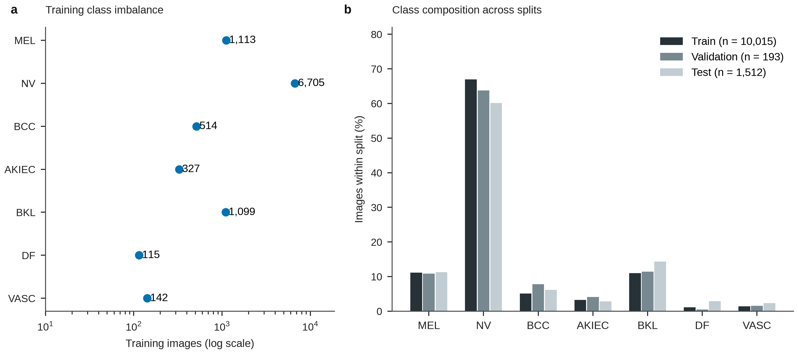

**Extended Data Fig. 1 |** Class imbalance across the ISIC splits. a, Training support for each diagnosis. b, Class composition in the training, validation and test sets. The validation set contains only one DF and three VASC images, limiting minority-class checkpoint assessment.

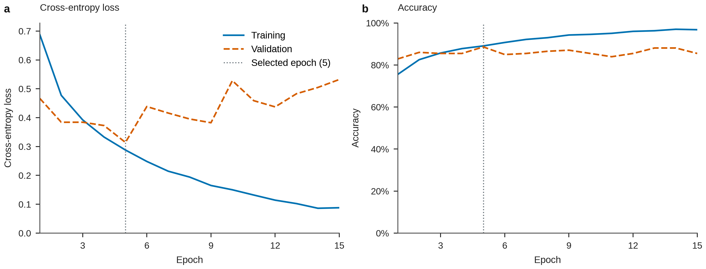

**Extended Data Fig. 2a |** Training and validation of the cross-entropy baseline. a, Ordinary cross-entropy loss. b, Accuracy. The vertical line marks the selected epoch. The checkpoint was selected using validation accuracy with a macro-F1 tie break.

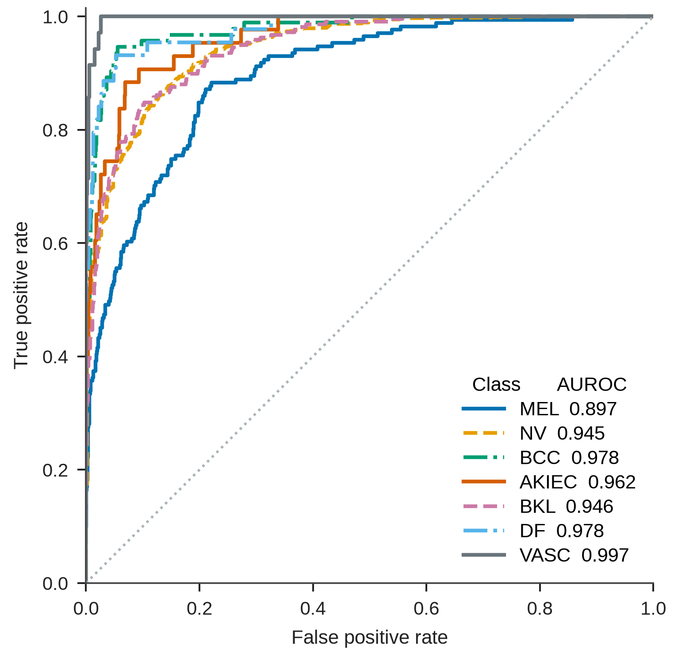

**Extended Data Fig. 2b |** Probability ranking in the cross-entropy baseline. One-versus-rest receiver operating characteristic curves for all seven diagnoses on the 1,512-image test set. Values in the legend are class-specific areas under the curve.

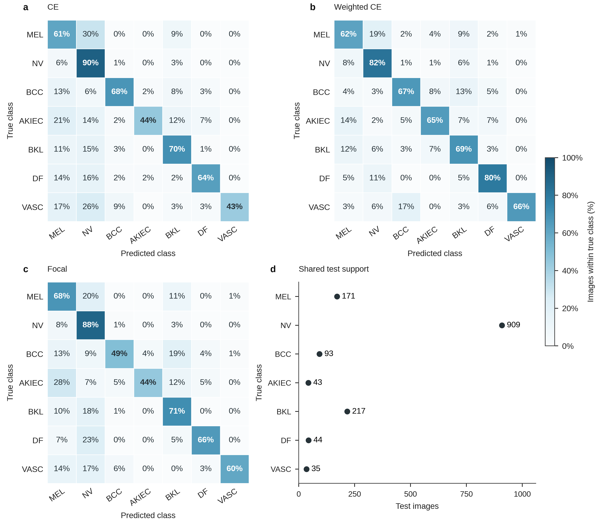

**Extended Data Fig. 3 |** Loss-specific classification errors and shared test support. a–c, Cross-entropy, weighted cross-entropy and focal confusion matrices. Ground-truth diagnoses form rows and predicted diagnoses columns; colours and values give row-normalized percentages on a common scale. d, The test support of each diagnosis (n = 1,512 images in total).

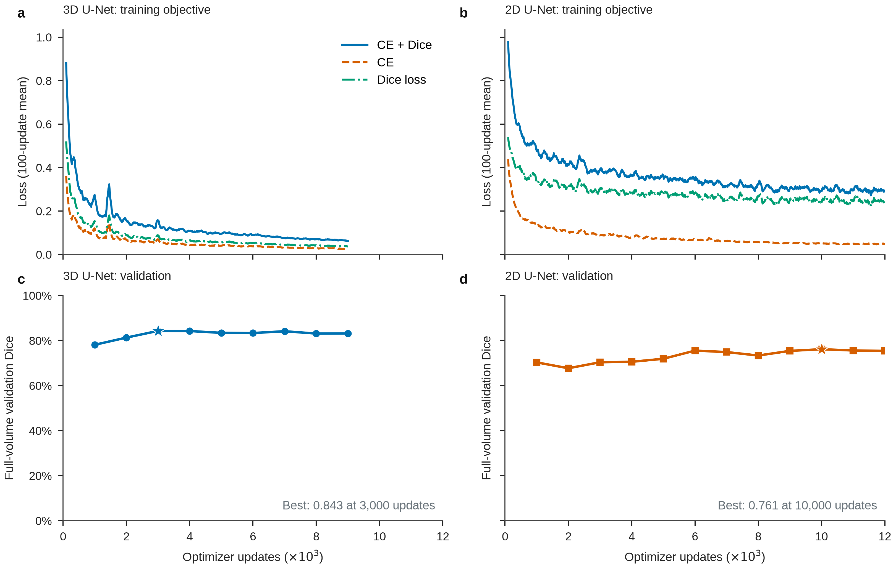

**Extended Data Fig. 4 |** Learning overlap from slices and volumes. The upper panels show the combined cross-entropy and Dice objective and its components, smoothed over 100 updates. The lower panels show mean Dice on complete validation volumes; stars identify the selected checkpoints.

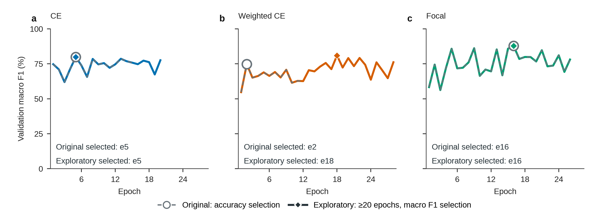

**Extended Data Fig. 5 |** Checkpoint selection under the exploratory protocol. Validation macro-F1 trajectories are shown for each objective, with markers for original accuracy-selected and supplementary macro-F1-selected checkpoints. The supplementary runs imposed a 20-epoch training floor while allowing selection from earlier epochs.

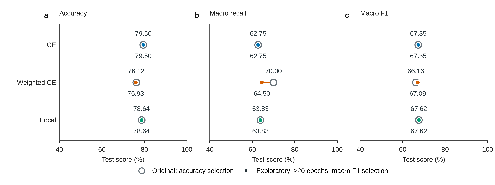

**Extended Data Fig. 6 |** The selection change alters the weighted-loss tradeoff. Original and exploratory test accuracy, macro recall and macro F1 are shown together for each objective. The sensitivity analysis was designed after observation of the primary test results.

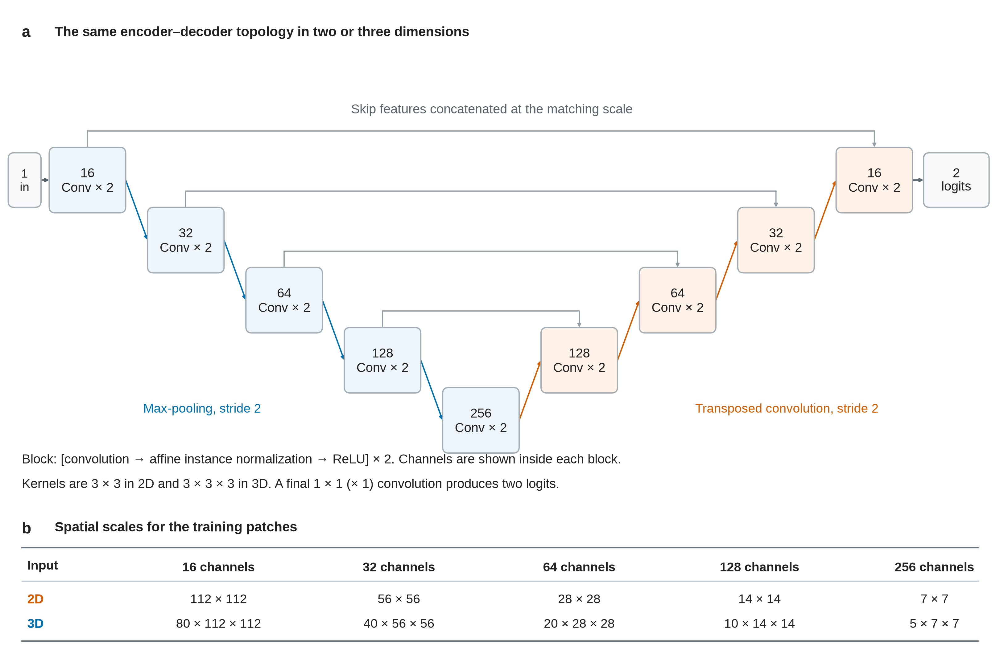

**Extended Data Fig. 7 |** U-Net architecture and patch scales. a, Both segmentation models have five encoder scales, four max-pooling operations, and four decoder scales with transposed-convolution upsampling. At each decoder scale, the upsampled features are concatenated with encoder features at the same resolution, then processed by a double-convolution block. Each convolution is followed by affine instance normalization and ReLU. The architecture uses 2D or 3D operations throughout, with base width 16 and a two-logit output. b, Spatial sizes after each encoder block for the actual 2D and 3D training patches. The decoder restores the original patch resolution. General inputs are padded to multiples of 16 before the forward pass and the final logits are cropped to the original size.

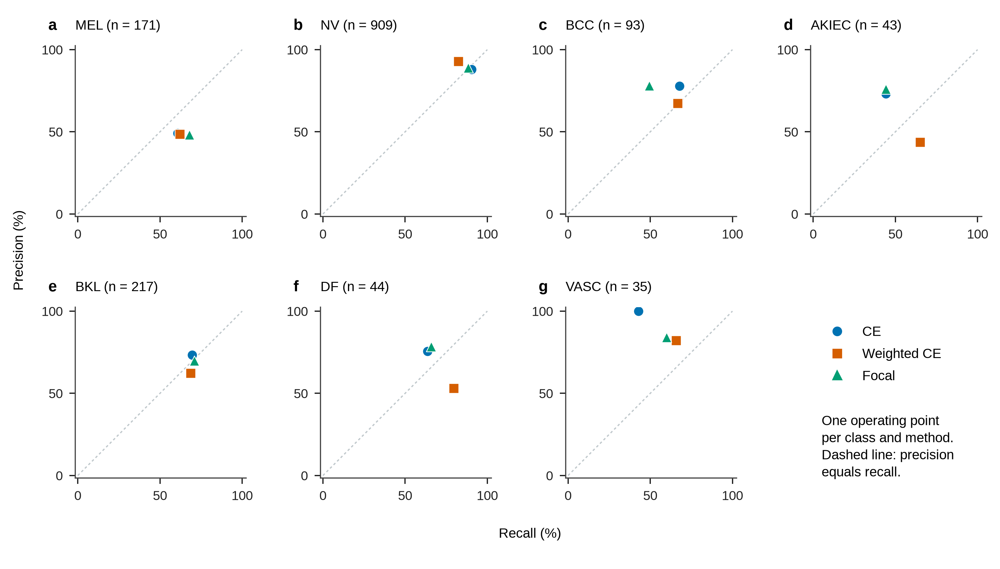

**Extended Data Fig. 8 |** Classwise precision and recall at fixed operating points. a–g, The seven diagnoses. Each point represents one model under multiclass argmax prediction; the dashed diagonal marks equal precision and recall. Counts state the test support of each diagnosis. These are single operating points, not precision–recall curves.

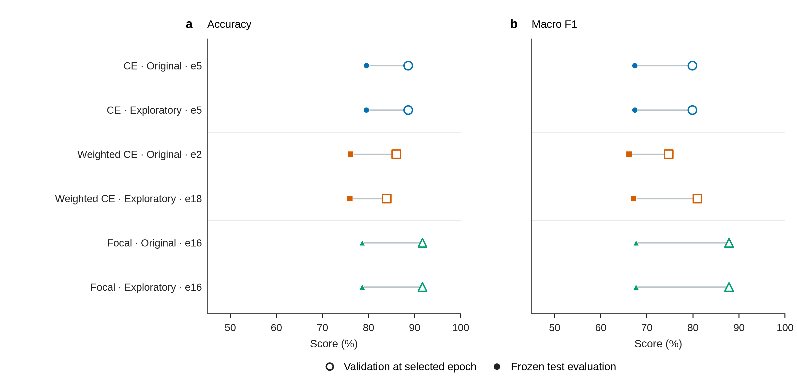

**Extended Data Fig. 9 |** Validation and test outcomes for selected models. a, Accuracy. b, Macro F1. Hollow symbols denote validation (n = 193 images) and filled symbols test (n = 1,512). Lines link the same fitted checkpoint across different partitions and do not represent paired image observations or an uncertainty interval. Original and exploratory checkpoints are shown without further selection.

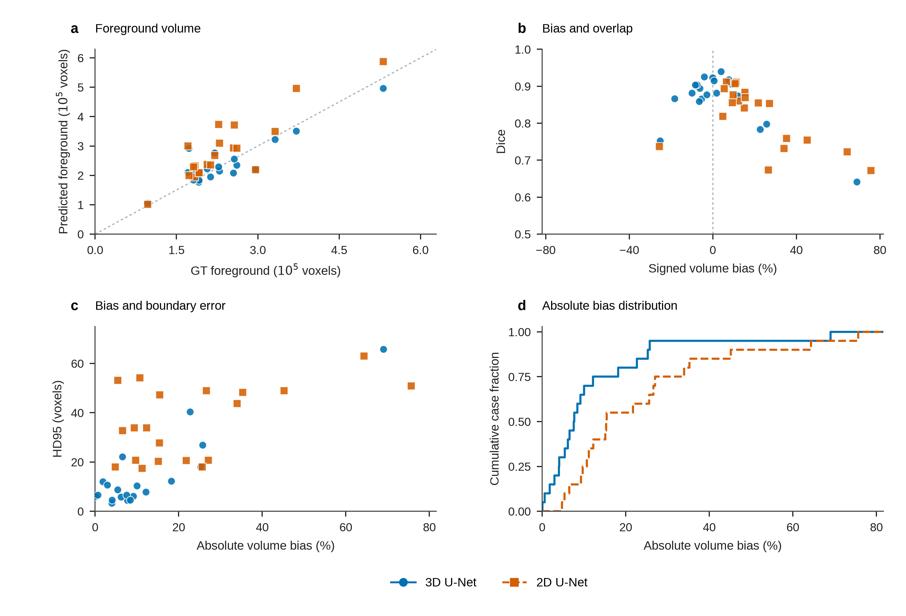

**Extended Data Fig. 10 |** Foreground voxel-count bias across complete volumes. a, Predicted versus reference counts; the diagonal denotes equality. b, Signed bias versus Dice. c, Absolute bias versus HD95. d, Empirical cumulative distribution of absolute bias. Every test volume is retained (n = 20 per model). Bias is $100(|P|-|R|)/|R|$, with positive values denoting overestimation. Voxel counts are not calibrated physical volumes.

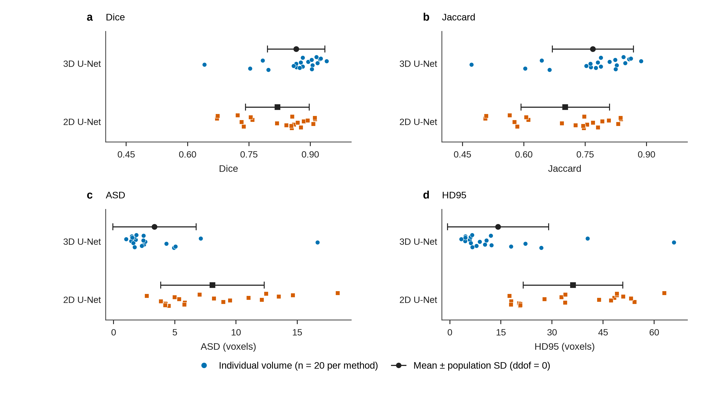

**Extended Data Fig. 11 |** Distribution of complete-volume segmentation outcomes. a–d, Dice, Jaccard, ASD and HD95. All 20 case values are shown per model; black markers give arithmetic means with population standard deviations (ddof = 0). These intervals describe cohort variation and are not confidence intervals. Surface distances use voxels; a symmetric SD interval may extend below zero without any negative observations.

## Supplementary tables

**Supplementary Table 1 |** Class support and inverse-frequency weights. Weights use training counts only.

| Diagnosis | Train | Validation | Test | Weight |
| --- | --- | --- | --- | --- |
| MEL | 1113 | 21 | 171 | 1.285 |
| NV | 6705 | 123 | 909 | 0.213 |
| BCC | 514 | 15 | 93 | 2.783 |
| AKIEC | 327 | 8 | 43 | 4.375 |
| BKL | 1099 | 22 | 217 | 1.302 |
| DF | 115 | 1 | 44 | 12.441 |
| VASC | 142 | 3 | 35 | 10.075 |

**Supplementary Table 2a |** Per-class outcomes for Cross-entropy. Precision, recall and F1 are percentages; AUROC uses [0,1].

| Diagnosis | Support | Precision | Recall | F1 | AUROC |
| --- | --- | --- | --- | --- | --- |
| MEL | 171 | 49.06 | 60.82 | 54.31 | 0.8971 |
| NV | 909 | 87.91 | 90.43 | 89.15 | 0.9447 |
| BCC | 93 | 77.78 | 67.74 | 72.41 | 0.9776 |
| AKIEC | 43 | 73.08 | 44.19 | 55.07 | 0.9620 |
| BKL | 217 | 73.30 | 69.59 | 71.39 | 0.9455 |
| DF | 44 | 75.68 | 63.64 | 69.14 | 0.9776 |
| VASC | 35 | 100.00 | 42.86 | 60.00 | 0.9971 |

**Supplementary Table 2b |** Per-class outcomes for Weighted cross-entropy. Precision, recall and F1 are percentages; AUROC uses [0,1].

| Diagnosis | Support | Precision | Recall | F1 | AUROC |
| --- | --- | --- | --- | --- | --- |
| MEL | 171 | 48.62 | 61.99 | 54.50 | 0.8920 |
| NV | 909 | 92.92 | 82.29 | 87.28 | 0.9405 |
| BCC | 93 | 67.39 | 66.67 | 67.03 | 0.9750 |
| AKIEC | 43 | 43.75 | 65.12 | 52.34 | 0.9697 |
| BKL | 217 | 62.34 | 68.66 | 65.35 | 0.9148 |
| DF | 44 | 53.03 | 79.55 | 63.64 | 0.9813 |
| VASC | 35 | 82.14 | 65.71 | 73.02 | 0.9955 |

**Supplementary Table 2c |** Per-class outcomes for Focal loss. Precision, recall and F1 are percentages; AUROC uses [0,1].

| Diagnosis | Support | Precision | Recall | F1 | AUROC |
| --- | --- | --- | --- | --- | --- |
| MEL | 171 | 48.13 | 67.84 | 56.31 | 0.9020 |
| NV | 909 | 88.94 | 88.45 | 88.69 | 0.9443 |
| BCC | 93 | 77.97 | 49.46 | 60.53 | 0.9831 |
| AKIEC | 43 | 76.00 | 44.19 | 55.88 | 0.9631 |
| BKL | 217 | 69.68 | 70.97 | 70.32 | 0.9426 |
| DF | 44 | 78.38 | 65.91 | 71.60 | 0.9812 |
| VASC | 35 | 84.00 | 60.00 | 70.00 | 0.9646 |

**Supplementary Table 3a |** Complete-volume outcomes for 3D U-Net. Overlap values are percentages; distances are in voxels.

| Case | Dice | Jaccard | ASD | HD95 |
| --- | --- | --- | --- | --- |
| LA-TE01 | 86.63 | 76.41 | 2.33 | 12.25 |
| LA-TE02 | 91.76 | 84.78 | 1.44 | 4.47 |
| LA-TE03 | 88.17 | 78.84 | 2.49 | 10.30 |
| LA-TE04 | 89.47 | 80.94 | 1.81 | 5.83 |
| LA-TE05 | 90.54 | 82.71 | 1.62 | 6.16 |
| LA-TE06 | 86.54 | 76.28 | 2.58 | 8.77 |
| LA-TE07 | 94.00 | 88.68 | 1.03 | 3.32 |
| LA-TE08 | 79.75 | 66.31 | 4.92 | 26.85 |
| LA-TE09 | 92.34 | 85.76 | 1.71 | 6.08 |
| LA-TE10 | 91.52 | 84.37 | 1.87 | 6.56 |
| LA-TE11 | 87.39 | 77.60 | 2.30 | 7.81 |
| LA-TE12 | 78.34 | 64.40 | 7.11 | 40.42 |
| LA-TE13 | 64.12 | 47.19 | 16.66 | 65.81 |
| LA-TE14 | 90.40 | 82.48 | 1.72 | 6.63 |
| LA-TE15 | 92.58 | 86.18 | 1.48 | 4.58 |
| LA-TE16 | 90.33 | 82.37 | 1.53 | 4.58 |
| LA-TE17 | 75.27 | 60.34 | 5.05 | 18.00 |
| LA-TE18 | 88.17 | 78.84 | 2.44 | 12.04 |
| LA-TE19 | 85.89 | 75.27 | 4.31 | 22.16 |
| LA-TE20 | 87.69 | 78.09 | 2.42 | 10.72 |

**Supplementary Table 3b |** Complete-volume outcomes for 2D U-Net. Overlap values are percentages; distances are in voxels.

| Case | Dice | Jaccard | ASD | HD95 |
| --- | --- | --- | --- | --- |
| LA-TE01 | 84.16 | 72.65 | 4.21 | 20.32 |
| LA-TE02 | 88.40 | 79.22 | 5.36 | 27.80 |
| LA-TE03 | 86.04 | 75.51 | 5.83 | 33.87 |
| LA-TE04 | 75.88 | 61.14 | 11.02 | 48.31 |
| LA-TE05 | 81.88 | 69.33 | 3.87 | 18.06 |
| LA-TE06 | 73.19 | 57.72 | 12.11 | 43.80 |
| LA-TE07 | 91.16 | 83.76 | 4.98 | 32.77 |
| LA-TE08 | 85.51 | 74.69 | 4.51 | 20.62 |
| LA-TE09 | 75.46 | 60.59 | 14.65 | 49.05 |
| LA-TE10 | 72.26 | 56.57 | 18.31 | 63.02 |
| LA-TE11 | 85.39 | 74.51 | 4.25 | 20.74 |
| LA-TE12 | 67.22 | 50.63 | 13.50 | 50.93 |
| LA-TE13 | 86.94 | 76.90 | 9.52 | 47.34 |
| LA-TE14 | 87.73 | 78.14 | 4.22 | 20.74 |
| LA-TE15 | 85.57 | 74.78 | 7.02 | 33.94 |
| LA-TE16 | 91.11 | 83.68 | 2.71 | 17.49 |
| LA-TE17 | 73.76 | 58.43 | 5.79 | 18.00 |
| LA-TE18 | 67.37 | 50.79 | 12.47 | 49.05 |
| LA-TE19 | 90.76 | 83.08 | 8.96 | 54.21 |
| LA-TE20 | 89.37 | 80.78 | 8.21 | 53.24 |

**Supplementary Table 4 |** Support-weighted classification outcomes, in percent.

| Objective | Precision | Recall | F1 |
| --- | --- | --- | --- |
| Cross-entropy | 80.30 | 79.50 | 79.41 |
| Weighted cross-entropy | 79.14 | 76.12 | 77.17 |
| Focal loss | 80.10 | 78.64 | 78.80 |

**Supplementary Table 5 |** Exploratory macro-F1 selection. Original selection maximized accuracy. Every epoch was eligible; training completed at least 20 epochs. Test columns are percentages.

| Objective | Selected epoch | Epochs run | Accuracy | Recall | F1 |
| --- | --- | --- | --- | --- | --- |
| Cross-entropy | 5 | 20 | 79.50 | 62.75 | 67.35 |
| Weighted cross-entropy | 18 | 28 | 75.93 | 64.50 | 67.09 |
| Focal loss | 16 | 26 | 78.64 | 63.83 | 67.62 |

**Supplementary Table 6 |** Measured resources for the original experiments. Times include data preparation and shared GPU workload.

| Model | Batch | Input | Epochs/updates | Parameters (M) | Time (min) | Peak (GiB) |
| --- | --- | --- | --- | --- | --- | --- |
| Cross-entropy | 16 | [224, 224] | 15 | 23.52 | 8.63 | 1.02 |
| Weighted cross-entropy | 16 | [224, 224] | 12 | 23.52 | 6.88 | 1.02 |
| Focal loss | 16 | [224, 224] | 26 | 23.52 | 15.17 | 1.02 |
| 3D U-Net | 1 | [80, 112, 112] | 9000 | 5.65 | 6.67 | 0.58 |
| 2D U-Net | 16 | [112, 112] | 12000 | 1.94 | 26.56 | 0.17 |

## Supplementary visual observations

### ISIC_0034556

The correctly classified NV image shows a central brown lesion with a darker lower focus. Activation is strongest over that focus and the central lesion, consistent with a contribution from local pigmentation and texture. A weaker upper-right background response suggests that the score may also depend on surrounding appearance. The predicted NV probability rounds to 100.00%.

### ISIC_0035845

In the correctly classified MEL image, blue-white and dark pigmentation varies across the lesion, with irregular margins and a brown lower extension. Activation concentrates in the lower central interior and extends towards the lower edge; the upper margin contributes less visibly. This pattern associates the MEL score with heterogeneous lesion appearance, without establishing how the complete boundary was assessed. The predicted MEL probability rounds to 100.00%.

### ISIC_0036005

The MEL image misclassified as NV is an unusually framed finger/nail or acral view with skin ridges and a strong vignette. NV-target activation peaks near a small dark upper-rim mark and the far-left presentation boundary, with weaker responses over much of the finger. The distribution raises the possibility of sensitivity to framing or peripheral appearance. The incorrect NV probability exceeds 99.99%, illustrating that a highly confident output can accompany a classification error.

### ISIC_0035724

The VASC image misclassified as MEL contains a very dark irregular centre, pale blue-white areas and peripheral redness. Activation is concentrated in the centre and along the lower lesion border. Dark pigmentation and colour variation may contribute to the MEL score, but the heatmap does not show whether vascular features were adequately represented. The incorrect MEL probability is 99.71%.

### LA-TE13

The lowest-Dice 3D case contains a substantial failure of the 3D model. At Z = 35, the annotation occupies a small image-right region, while the 3D prediction includes a large unrelated image-left structure and misses part of the annotated region. The 2D prediction is closer on this slice and over the complete volume: Dice is 86.94% versus 64.12%, and HD95 is 47.34 versus 65.81 voxels. The 3D mask contains 142,910 false-positive and 23,753 false-negative voxels, with only 54.88% of its prediction in the largest connected component. Predicted foreground volume exceeds the annotation by 69.00%, compared with 15.43% for 2D. Remote excess foreground accounts for both poor overlap and large boundary displacement; even the better 2D result retains substantial surface error.

### LA-TE18

The median-ranked 3D case illustrates improved global geometry with residual local errors. At Z = 61, both models recover much of the main annotated region but extend the image-left protrusion and incompletely reproduce a smaller separate cross-section. A small 3D false-positive spot is also visible. Complete-volume Dice is 88.17% for 3D and 67.37% for 2D, with HD95 of 12.04 and 49.05 voxels. The 3D voxel-volume bias is only 1.83%, but this small net difference combines 23,257 false-positive with 19,953 false-negative voxels. The 2D bias is 26.60%. Near-correct total volume therefore conceals errors in shape and continuity.

### LA-TE07

The highest-Dice 3D case has 94.00% complete-volume Dice and an HD95 of 3.32 voxels, yet its selected slice contains a local omission. At Z = 66, the model follows the larger central cross-section but misses the small image-left annotated region and slightly extends an upper-right structure. There are 415 false-negative voxels on this slice. The 2D prediction captures more of the left cross-section locally, but its complete-volume Dice is lower (91.16%) and HD95 is much higher (32.77 voxels). Inspection of the full 2D mask identifies 14 connected components, with 3.30% of its predicted voxels outside the largest component and its greatest false-positive burden at Z = 16. These remote errors explain why a favourable slice can coexist with poor full-volume surface distance.

### LA-TE12

The case with the highest remaining 3D HD95 shows connected overgrowth. At Z = 33, both models include a large image-left structure outside the annotation; 3D also extends beyond the small annotated cross-section, while 2D expands both visible regions more extensively. Complete-volume Dice is 78.34% for 3D and 67.22% for 2D, with HD95 of 40.42 and 50.93 voxels. Foreground volume exceeds the annotation by 22.68% and 75.62%, respectively, corresponding to 60,651 and 141,965 false-positive voxels. For 3D, 99.69% of predicted voxels belong to one component. The error is therefore largely an expansion of the main predicted structure, which would persist after removal of small isolated components. The reported masks were evaluated without such correction.
